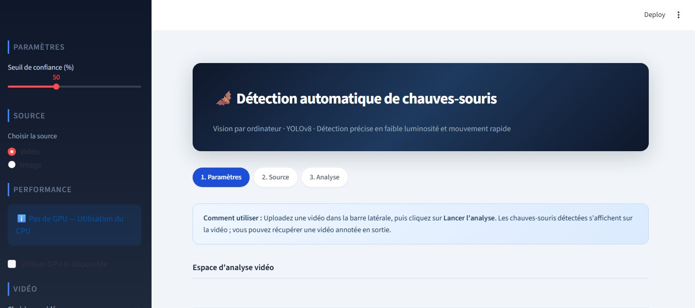
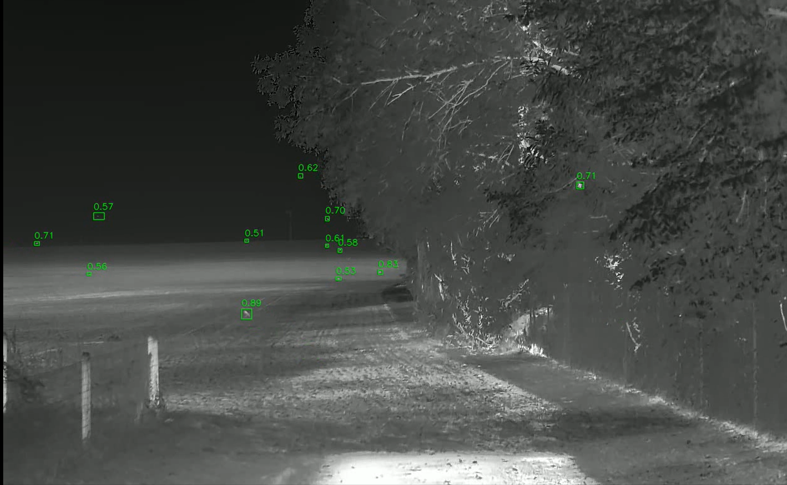
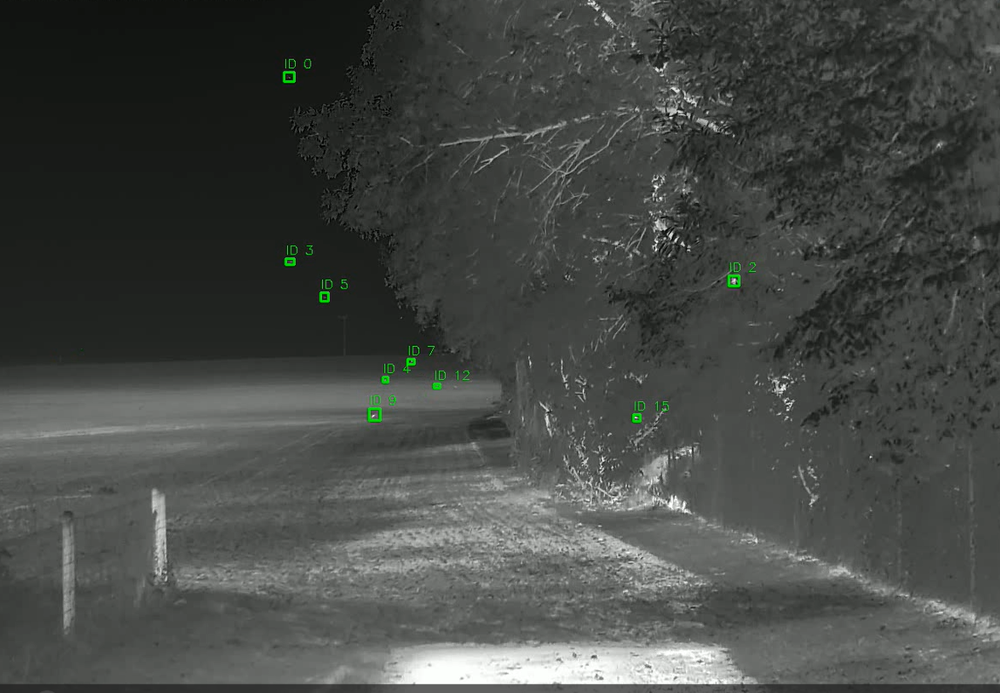

# 🦇 Bat Detection and Tracking

An AI-powered project designed to detect and track bats in thermal videos using Computer Vision and Deep Learning.

The main goal is to automate bat detection, follow their movements, and analyze their activity through an interactive Streamlit application.

## 🔄 Project Workflow

The project was developed through the following steps:

1. **Data Collection:** Collecting thermal images and videos of bats.
2. **Data Annotation:** Labeling bats using Roboflow.
3. **Data Preprocessing:** Preparing and augmenting images for model training.
4. **Model Training:** Training and comparing YOLOv8 models (YOLOv8s and YOLOv8m).
5. **Hyperparameter Optimization:** Using Optuna to improve model performance.
6. **Object Detection:** Detecting bats in thermal images and videos using YOLOv8 and SAHI.
7. **Object Tracking:** Developing a custom tracking algorithm called BatTracker to follow bats across video frames.
8. **Application Development:** Building an interactive Streamlit application to visualize detection and tracking results.

## 🛠️ Technologies Used

- **Python** – Main programming language
- **YOLOv8** – Object detection
- **PyTorch** – Deep Learning framework
- **OpenCV** – Image and video processing
- **SAHI** – Small object detection in high-resolution images
- **Optuna** – Hyperparameter optimization
- **Roboflow** – Data annotation and preparation
- **Streamlit** – Interactive web application
- **NumPy** – Data processing
- **FFmpeg** – Video processing

## 🖥️ Application Interface

An interactive Streamlit application was developed to make bat detection and analysis easier.

The application allows users to:
- Upload thermal images and videos.
- Adjust the detection confidence threshold.
- Choose between image and video analysis.
- Run automatic bat detection.
- Visualize detection and tracking results.
- Export processed videos and analysis results.

### Application Screenshot



## 📸 Detection & Tracking Results

### Bat Detection

The YOLOv8 model detects bats in thermal videos and displays bounding boxes with confidence scores.



### Bat Tracking

A custom tracking algorithm called BatTracker assigns a unique ID to each detected bat, making it possible to follow individual bats across consecutive video frames.



## 📊 Model Performance

The YOLOv8s model achieved the following results on our dataset:

| Evaluation Metric | Performance |
|---|---:|
| Precision | 89% |
| Recall | 93% |
| mAP | 94% |

These results demonstrate the model's ability to detect bats in thermal videos, including small and fast-moving objects.

## 🚀 Installation & Usage

### 1. Clone the repository

```bash
git clone https://github.com/nassimelaouad/bat-detection-tracking.git
cd bat-detection-tracking
```

### 2. Create a virtual environment

```bash
python -m venv venv
```

### 3. Activate the environment

**Windows PowerShell:**

```powershell
.\venv\Scripts\Activate.ps1
```

### 4. Install dependencies

```bash
pip install -r requirements.txt
```

Make sure the `sahi` package is installed if SAHI is enabled in the configuration.

### 5. Run the application

```bash
streamlit run app.py
```

The application will open automatically in your web browser.

**Note:** The trained model weights must be available locally. Configure the model path in `settings.py` before running the application.

---

## 👨‍💻 Project

Engineering project developed at EILCO in collaboration with Ecosphère.


**Main Areas:** Computer Vision | Deep Learning | Object Detection | Object Tracking
